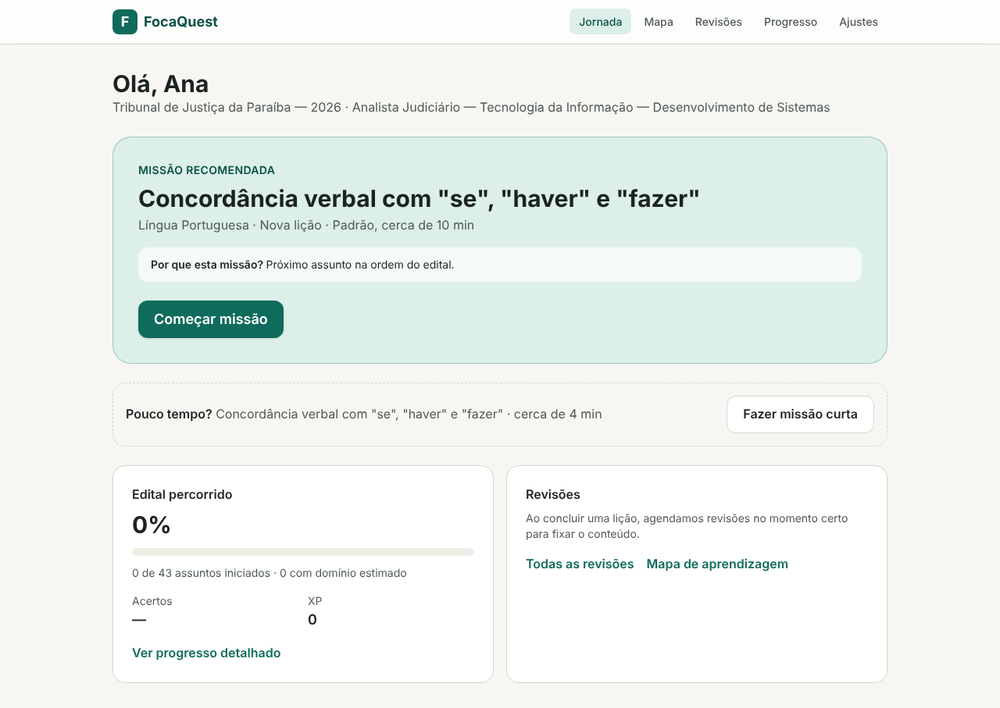
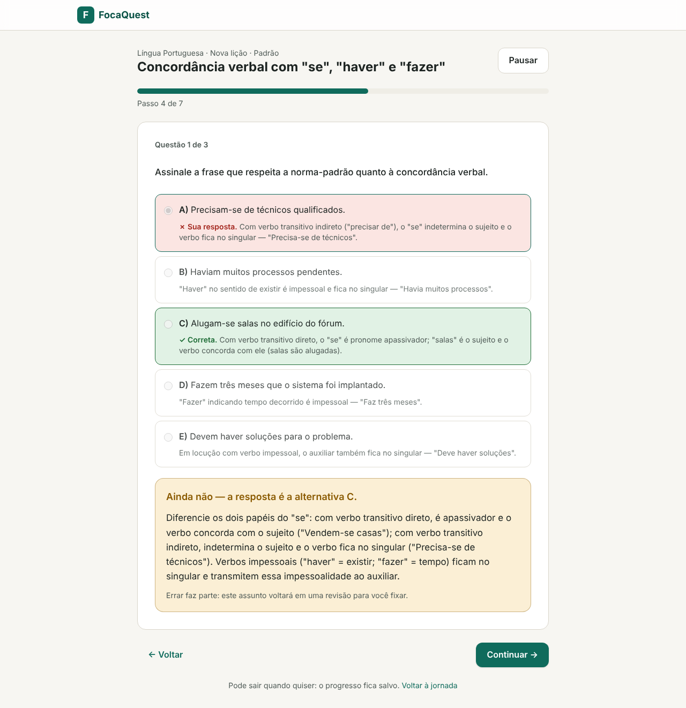
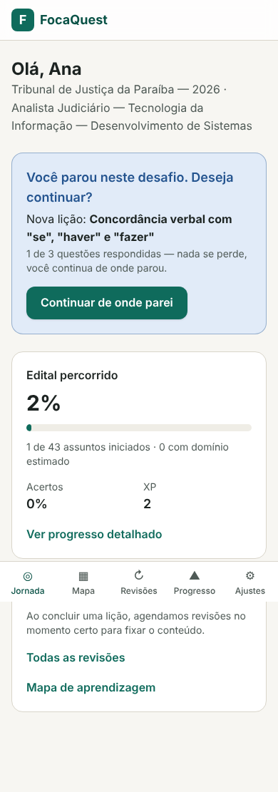

# FocaQuest

Plataforma de aprendizagem adaptativa para concursos públicos. O estudante abre o app, recebe
uma **missão recomendada** e começa a estudar na hora: microlição, exemplo aplicado, questões no
formato da banca com feedback comentado, e revisões espaçadas agendadas automaticamente.

Primeiro concurso: **TJPB 2026 — Analista Judiciário, TI — Desenvolvimento de Sistemas (FGV)**.

| Jornada | Feedback comentado | Retomada no celular |
|---|---|---|
|  |  |  |

## O que já funciona (MVP, PRD §10)

| Critério do PRD | Onde |
|---|---|
| Selecionar TJPB e Desenvolvimento de Sistemas | `/onboarding` |
| Iniciar uma missão (Micro, Padrão ou Aprofundada) | `/` → **Começar missão** |
| Aprender um conceito (objetivo → explicação → exemplo) | `/missao/[id]` |
| Resolver questões relacionadas (5 alternativas, formato FGV) | `/missao/[id]` |
| Receber feedback comentado de **cada** alternativa | após responder |
| Interromper e retomar sem refazer o que já respondeu | **Pausar** → "Você parou neste desafio. Deseja continuar?" |
| Consultar o progresso (edital percorrido, acertos, domínio, XP) | `/progresso`, `/mapa` |
| Executar uma revisão recomendada | `/revisoes` e na jornada |
| Usar no computador e no celular (PWA responsivo) | todas as telas |

Tudo isso é coberto por testes automatizados: `MvpFlowIT` percorre o ciclo completo pela API, e
os testes do frontend cobrem o player de missões.

## Estrutura

```
apps/api      Spring Boot 4 (Java 21) — monólito modular
apps/web      Next.js 16 + TypeScript + Tailwind CSS 4 (PWA)
content/      Conteúdo versionado (edital, lições, questões) em YAML
docs/         PRD, arquitetura, modelo de dados, formato de conteúdo, ADRs, OpenAPI
infra/        docker-compose.yml
```

## Rodando

### Com Docker (tudo junto)

```bash
docker compose -f infra/docker-compose.yml up --build
# http://localhost:3000 · API http://localhost:8080 · Swagger http://localhost:8080/swagger-ui.html
```

### Em desenvolvimento

Pré-requisitos: Java 21, Node 22.22+ (ou 24) e PostgreSQL 16 (ou `docker compose -f infra/docker-compose.yml up db`).

```bash
# API — aplica as migrations (Flyway) e importa content/ na inicialização
cd apps/api && ./mvnw spring-boot:run

# Web — /api é repassado para http://localhost:8080 (FOCAQUEST_API_URL)
cd apps/web && npm install && npm run dev
```

Variáveis da API: `FOCAQUEST_DB_URL`, `FOCAQUEST_DB_USER`, `FOCAQUEST_DB_PASSWORD`,
`FOCAQUEST_JWT_SECRET` (obrigatório trocar fora do ambiente local), `FOCAQUEST_SECURE_COOKIE`
(`true` com HTTPS), `FOCAQUEST_CONTENT_PATH`, `FOCAQUEST_IMPORT_CONTENT`.

## Testes

```bash
cd apps/api && ./mvnw verify      # unitários + integração (Testcontainers sobe o PostgreSQL)
# sem Docker: FOCAQUEST_TEST_DB_URL=jdbc:postgresql://localhost:5432/focaquest_test ./mvnw verify

cd apps/web && npm test && npm run typecheck
```

- **Regras críticas** (unitários): escada de revisão, cálculo de domínio, seleção de questões,
  motor de recomendação, validação de conteúdo.
- **Integração**: fluxo completo do MVP, idempotência e versionamento da importação, segurança
  (autenticação, isolamento entre estudantes, gabarito nunca enviado antes da resposta).

## Conteúdo

Lições e questões ficam em `content/tjpb-2026/` e são importadas de forma **idempotente** a
cada inicialização. Qualquer erro (gabarito inexistente, alternativa sem comentário, menos de 5
alternativas no formato FGV, referência a tópico inexistente…) rejeita a importação inteira, e o
CI valida o conteúdo em todo pull request. Veja [docs/content-format.md](docs/content-format.md).

> ⚠️ **Revisão editorial pendente.** A árvore de tópicos do edital foi montada a partir dos
> agrupamentos do PRD e precisa ser conferida item a item com o edital oficial publicado. As 47
> questões e 14 microlições são **inéditas** (não reproduzem questões de provas), mas também
> devem passar por revisão antes do uso com estudantes.

## Documentação

- [PRD v2.0](docs/PRD-FocaQuest-v2.0.pdf) e [status do PRD](docs/prd.md)
- [Arquitetura](docs/architecture.md) · [Modelo de dados](docs/data-model.md)
- [Formato do conteúdo](docs/content-format.md) · [ADRs](docs/adr/)
- API: [OpenAPI](docs/api/openapi.json) ou Swagger UI em `/swagger-ui.html`

## Licença

Código sob a licença [MIT](LICENSE).
